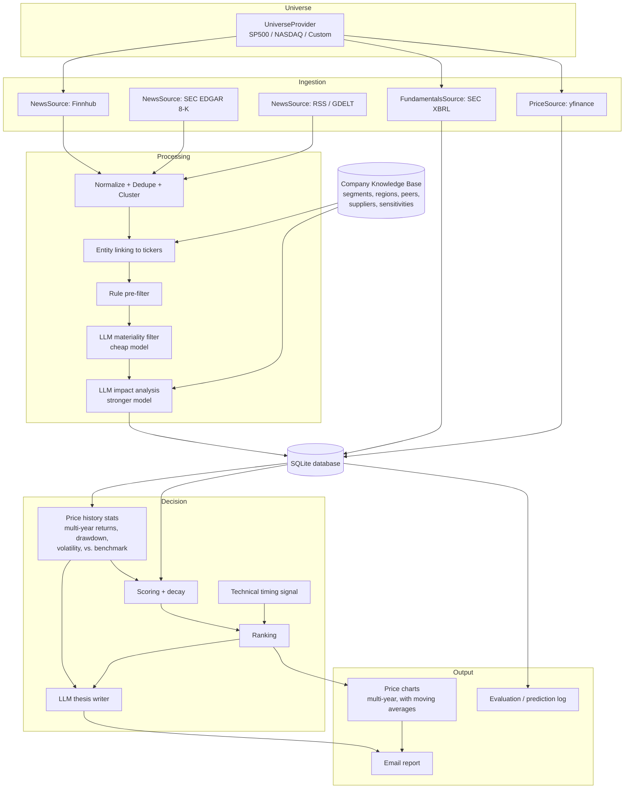

# Stock Investment AI Agent — Design Document

Status: Draft v1
Scope: Weekly news-driven analysis of public companies, producing mid- and long-term investment ideas delivered by email.

---

## 1. Goals and non-goals

### Goals
1. Continuously collect news and regulatory filings relevant to the companies in a configurable **universe** (initially the full S&P 500).
2. For each material event, estimate **which companies are affected, in which direction, on which revenue line, how much, and over what horizon** (mid term: 6–18 months; long term: 2–5 years).
3. Combine news impact with fundamentals, valuation, **multi-year price history**, and a technical timing signal into a ranked list of investment candidates.
4. Email a weekly report with ranked ideas, the reasoning behind them, risks, source links, and a **multi-year price chart** for every highlighted company.
5. Log every prediction so accuracy can be measured over time.

### Non-goals (v1)
- Automated trading or order placement.
- Intraday / high-frequency reaction to headlines.
- Options, crypto, or non-US markets (the design leaves room for them later).

### Constraints
| Constraint | Decision |
|---|---|
| LLM vendor | Must be swappable via config (OpenAI, Anthropic, Gemini, local models, …) |
| Budget | ≤ ~$50/month total for data + LLM |
| Universe | Full S&P 500 first; pluggable for NASDAQ, custom watchlists, other indices |
| Delivery | Weekly email report |
| Runtime | Python 3.10+, runs on a Mac via a scheduler; portable to a cloud VM later |

---

## 2. High-level architecture



Every arrow crosses a **plugin interface** (Section 4), so sources, LLM vendors, universes, and outputs can be swapped without touching the core pipeline.

---

## 3. Pipeline schedule

The agent targets mid- and long-term investing, so analysis and reporting run **weekly**. Only raw data collection runs daily, because some sources (RSS feeds in particular) keep only their most recent items and would lose stories if polled once a week. The daily job uses no LLM calls and costs nothing.

### 3.1 Daily collection job (lightweight, no LLM)
Runs once per day after US market close (e.g. 6:00 PM ET).

| Step | What happens | Output |
|---|---|---|
| 1. News ingestion | Pull articles/filings published since the last run from every enabled source | `articles` |
| 2. Prices | Store the day's prices for all tickers | `prices` |
| 3. Critical-filing check (optional) | Rule-based scan of new 8-Ks for watched companies for severe item types (e.g. bankruptcy, delisting notice, auditor change, non-reliance on prior financials); sends a short alert email if found | `alerts_sent` |

### 3.2 Weekly analysis job
Runs once per week after Friday's close (e.g. Saturday morning), covering everything collected since the previous run.

| Step | What happens | Output |
|---|---|---|
| 1. Universe refresh | Load tickers from the configured universe(s); refresh membership | `companies`, `universe_members` |
| 2. Fundamentals | Refresh fundamentals for companies that filed a 10-Q/10-K during the week | `fundamentals` |
| 3. Normalize + dedupe | Canonicalize URLs, strip boilerplate, hash text, cluster near-duplicates across the whole week by embedding similarity (a story repeated over several days becomes one cluster) | `article_clusters` |
| 4. Entity linking | Map mentioned companies to tickers; expand to peers/suppliers/customers via knowledge base | `cluster_entities` |
| 5. Rule pre-filter | Drop low-value items (stock-price recaps, listicles, "stocks to watch", duplicate wire copies) | reduced cluster set |
| 6. LLM materiality filter | Cheap model, batched: "Is this material to any company's revenue/earnings over 6+ months?" | `materiality` flag + reason |
| 7. LLM impact analysis | Stronger model, one call per material cluster, returns structured impacts per affected ticker | `impacts` (the prediction log) |
| 8. Price history stats | Compute multi-year return, drawdown, volatility, and benchmark-relative statistics for every ticker (Section 8.5) | `price_stats_weekly` |
| 9. Scoring | Aggregate impacts with time decay; merge fundamentals, valuation, price history, technicals | `scores_weekly` |
| 10. Ranking + thesis | Pick top candidates and biggest week-over-week changes; LLM writes concise thesis/risks with price history as context | `recommendations` |
| 11. Charts | Render a multi-year price chart for every highlighted ticker (Section 10.2) | PNG files + PDF |
| 12. Evaluation | Compare past predictions with realized revenue/price outcomes | `evaluation_metrics` |
| 13. Email | Render the weekly HTML report with inline charts and the chart PDF attached, send, record delivery | `reports_sent` |

Each step is idempotent and checkpointed, so a failed run can resume without re-paying for LLM calls. If a week's run is missed, the next run processes all unanalyzed articles.

---

## 4. Plugin interfaces

All plugins are plain Python classes registered by name and selected in `config/settings.yaml`.

### 4.1 LLM provider (vendor-agnostic)

```python
class LLMProvider(Protocol):
    name: str

    def complete(
        self,
        messages: list[Message],
        *,
        model: str,
        response_schema: type[BaseModel] | None = None,
        temperature: float = 0.0,
        max_tokens: int | None = None,
    ) -> LLMResult: ...

    def embed(self, texts: list[str], *, model: str) -> list[list[float]]: ...


@dataclass
class LLMResult:
    text: str
    parsed: BaseModel | None
    input_tokens: int
    output_tokens: int
    cost_usd: float
    model: str
    provider: str
```

Implementation options:
- **Recommended:** a thin adapter over [LiteLLM](https://github.com/BerriAI/litellm), which already speaks to OpenAI, Anthropic, Gemini, Mistral, Groq, Ollama (local), and more with one API.
- Native adapters per vendor can be added later if a vendor-specific feature is needed.

**Task-based model routing** — the pipeline never names a vendor directly; it asks for a *role*:

```yaml
llm:
  roles:
    filter:   { provider: litellm, model: "gemini/gemini-flash-latest" }
    analysis: { provider: litellm, model: "openai/gpt-mini-latest" }
    thesis:   { provider: litellm, model: "anthropic/claude-haiku-latest" }
    embed:    { provider: local,   model: "all-MiniLM-L6-v2" }
  weekly_budget_usd: 10
  monthly_budget_usd: 40
```

Model names above are placeholders; any vendor/model pair can be configured per role.

Cross-cutting features implemented once, in a wrapper around every provider:
- **Structured output** validated with Pydantic; one automatic repair retry on invalid JSON.
- **Response cache** keyed on (model, prompt hash) so reruns are free.
- **Budget guard**: tracks spend in `llm_calls`; when the weekly cap is hit, the pipeline degrades gracefully (analyze only the highest-priority clusters, skip theses) instead of failing.
- **Retry with backoff** and optional fallback provider per role.

### 4.2 Universe provider

```python
class UniverseProvider(Protocol):
    name: str  # "sp500", "nasdaq", "custom:my_watchlist"
    def list_members(self) -> list[Security]: ...

@dataclass
class Security:
    ticker: str
    exchange: str          # "NYSE", "NASDAQ", ...
    name: str
    cik: str | None        # SEC identifier, used for filings
    sector: str | None
    industry: str | None
```

Initial implementations:
- `SP500Universe` — reads the S&P 500 constituents table (ticker, name, sector, industry, CIK) from Wikipedia, with a cached copy as fallback.
- `NasdaqUniverse` — reads the official Nasdaq Trader symbol directory, excluding ETFs and test issues.
- `CustomListUniverse` — reads a CSV/YAML watchlist.

Multiple universes can be active at once; a company appears once in `companies` and can belong to several universes.

### 4.3 Data sources

```python
class NewsSource(Protocol):
    name: str
    def fetch(self, since: datetime, securities: list[Security]) -> Iterable[RawArticle]: ...

class FundamentalsSource(Protocol):
    def fetch(self, security: Security) -> FundamentalsSnapshot: ...

class PriceSource(Protocol):
    def history(self, securities: list[Security], start: date, end: date) -> pd.DataFrame: ...
```

### 4.4 Notifier

```python
class Notifier(Protocol):
    def send(self, report: Report) -> None: ...
```

v1: `EmailNotifier` (SMTP). Later: Slack, Telegram, etc., with no pipeline changes.

---

## 5. Data sources (within budget)

| Purpose | Source | Cost | Notes |
|---|---|---|---|
| Company news | **Finnhub** `company-news` endpoint | Free tier | Per-ticker news; free tier rate limit (~60 calls/min) means ~10 min to sweep 500 tickers — fine for the daily collection job |
| Material corporate events | **SEC EDGAR** 8-K feed + full-text search | Free | Highest-signal source: earnings, M&A, guidance, executive changes, material agreements. Requires a descriptive `User-Agent` header |
| Macro / industry news | **GDELT** + curated **RSS** feeds (Fed, BLS, major outlets' business feeds, industry trade press) | Free | Captures events not tied to one ticker (tariffs, rates, regulation) |
| Fundamentals | **SEC XBRL `companyfacts` API** | Free | Official reported revenue, margins, segments; more reliable than scraping |
| Prices | **yfinance** | Free | Unofficial and occasionally breaks; wrapped behind `PriceSource` so it can be replaced. A one-time backfill loads **5 years** (configurable) of daily prices for every ticker plus benchmarks (SPY and the 11 SPDR sector ETFs); the daily job then appends new days |
| Segment/region mix, competitors, suppliers | **10-K text** (EDGAR) parsed by LLM once per year per company | One-off LLM cost | Feeds the knowledge base |

Sources deliberately **not** used in v1: paid newswires, paid transcript services, and scraping sites whose terms forbid it. All can be added later as `NewsSource` plugins.

---

## 6. Company knowledge base

The knowledge base is what lets the agent reason about **second-order effects** (e.g. a tariff on Chinese components hurting a US hardware maker's margins, or a hyperscaler's capex increase helping its chip and power suppliers).

### Contents per company
| Field | Source | Refresh |
|---|---|---|
| Sector, industry | Wikipedia S&P table / SEC SIC code | Weekly |
| Revenue by segment and by geography (latest FY + trend) | XBRL facts, fallback to 10-K LLM extraction | When a 10-K/10-Q is filed |
| Business description summary | 10-K Item 1, LLM-summarized | Annually |
| Named competitors, key customers, key suppliers | 10-K text, LLM-extracted | Annually |
| Key sensitivities (rates, FX, commodity, China, AI capex, consumer spending, regulation…) | LLM-extracted from 10-K Item 1A risk factors, mapped to a fixed taxonomy | Annually |

### Relationship graph
Stored as an edge table `company_relations(src_ticker, dst_ticker, relation, evidence, confidence)` with relations `competitor`, `supplier_of`, `customer_of`, `partner`. Only edges where both sides are in a tracked universe are linked to tickers; the rest are kept as free-text names for future universes.

### Sensitivity taxonomy
A fixed list (~30 factors) such as `interest_rates`, `usd_strength`, `oil_price`, `china_exposure`, `tariffs`, `ai_capex`, `consumer_discretionary_spend`, `healthcare_policy`, `defense_budget`. Macro news is tagged with the same taxonomy, so a macro event can be routed to every company exposed to that factor without an LLM call per company.

---

## 7. LLM analysis design

### 7.1 Materiality filter (cheap model, batched)
- Input: headline + first ~2 sentences of each cluster, 20–30 clusters per call.
- Output per cluster: `{cluster_id, material: bool, category, reason}`.
- Categories: `earnings`, `guidance`, `m_and_a`, `regulation`, `litigation`, `product`, `contract`, `management`, `macro`, `supply_chain`, `other`.
- Target: keep roughly 5–15% of clusters.

### 7.2 Impact analysis (stronger model, one call per material cluster)

Prompt context:
1. Full cluster text (deduped, truncated to a token limit).
2. Knowledge-base profile for each directly mentioned company and its linked peers/suppliers/customers (segments, regions, sensitivities).
3. Recent fundamentals (last 4 quarters revenue/growth/margin).
4. Price history statistics (Section 8.5), so the model can judge how much may already be priced in.
5. Instructions to reason about **revenue lines**, **horizon**, and **uncertainty**, and to say "no meaningful impact" when appropriate.

Structured output (validated by Pydantic):

```python
class Impact(BaseModel):
    ticker: str
    relation: Literal["direct", "competitor", "supplier", "customer", "macro_exposure"]
    direction: Literal["positive", "negative", "neutral"]
    affected_revenue_line: str              # e.g. "Data Center — China"
    est_revenue_impact_pct: float           # signed, % of total company revenue
    horizon: Literal["mid", "long"]         # mid = 6–18 months, long = 2–5 years
    confidence: float                       # 0–1
    already_priced_in: Literal["likely", "partially", "unlikely"]
    reasoning: str                          # ≤ 120 words
    key_uncertainties: list[str]

class EventAnalysis(BaseModel):
    cluster_id: str
    event_summary: str
    event_type: str
    impacts: list[Impact]
```

### 7.3 Guardrails
- **Grounding:** reasoning may only rely on the supplied text and knowledge-base facts; source URLs are attached by the pipeline, not generated by the model.
- **Magnitude sanity checks:** `|est_revenue_impact_pct|` above a threshold (e.g. 10%) requires confidence ≥ 0.6, otherwise it is clipped and flagged.
- **Ticker validation:** impacts on tickers outside the tracked universe or not present in the context are dropped.
- **Prompt versioning:** every stored impact records `prompt_version` and `model`, so results from different prompts/models can be compared during evaluation.

### 7.4 Thesis writer
For the top ~10 ranked companies and the ~5 biggest score changes of the week, a final call summarizes: the investment thesis, supporting events (with links), bear case, key risks, and what would invalidate the thesis.

The thesis writer also receives the company's **price history statistics** (Section 8.5) and must comment on them, e.g. whether a strong positive news view conflicts with a stock that has already tripled in three years, or whether a long drawdown suggests the market is skeptical of the thesis. The same statistics are given to the impact analysis (Section 7.2) to inform the `already_priced_in` judgment.

---

## 8. Scoring and ranking

### 8.1 News impact score
For company *c*, horizon *h* ∈ {mid, long}, on day *t*:

\[
\text{News}_{c,h}(t) = \sum_{i \in \text{impacts}(c,h)} s_i \cdot m_i \cdot k_i \cdot w_{\text{src},i} \cdot w_{\text{rel},i} \cdot e^{-(t - t_i)/\tau_h}
\]

| Symbol | Meaning |
|---|---|
| \(s_i\) | +1 positive, −1 negative, 0 neutral |
| \(m_i\) | \(\lvert\)est. revenue impact %\(\rvert\), capped |
| \(k_i\) | model confidence |
| \(w_{\text{src},i}\) | source reliability (SEC filing > major outlet > aggregator) |
| \(w_{\text{rel},i}\) | relation weight (direct 1.0, competitor/supplier/customer ~0.5, macro ~0.3) |
| \(\tau_h\) | decay constant: ~90 days for mid, ~365 days for long |
| \(\text{already\_priced\_in}\) | multiplier: likely 0.3, partially 0.6, unlikely 1.0 |

Raw scores are converted to **cross-sectional z-scores within sector**, so sectors with heavy news coverage do not dominate.

The pipeline also stores a plain-language companion metric: **net estimated revenue impact %** per company and horizon, which is easier to read in the email than a z-score.

### 8.2 Other factors
| Factor | Inputs |
|---|---|
| Fundamentals quality | Revenue growth (TTM, YoY), gross/operating margin trend, FCF margin |
| Valuation | EV/Sales and P/E vs. sector median and vs. own 5-year history |
| Technical timing | Price trend vs. 20/60/120/200-day moving averages, moving-average convergence, and 3/6/12-month momentum (`analysis/technical.py`) |
| Risk penalty | High multi-year volatility, deep or prolonged drawdown, high leverage (price inputs from Section 8.5) |

### 8.3 Composite score
\[
\text{Score}_c = w_1 \cdot \text{News}_{c,\text{mid}} + w_2 \cdot \text{News}_{c,\text{long}} + w_3 \cdot \text{Quality}_c + w_4 \cdot \text{Value}_c + w_5 \cdot \text{Technical}_c - w_6 \cdot \text{Risk}_c
\]

Initial weights are set in config (e.g. 0.25, 0.25, 0.2, 0.15, 0.1, 0.05) and later tuned from evaluation results — not by hand-picking winners.

### 8.4 Output lists
- **Top long-term ideas** (rank by Score, require News_long > 0 and Quality above sector median).
- **Top mid-term ideas** (rank by Score with higher weight on News_mid and Technical).
- **Biggest negative changes** in holdings/watchlist (risk alerts).

### 8.5 Price history statistics
Computed weekly for every ticker from stored daily prices (no LLM, no extra cost) over a configurable lookback (default 5 years):

| Statistic | Definition |
|---|---|
| Total return | 1-, 3-, and 5-year price return |
| CAGR | Annualized return over the full lookback |
| Relative performance | Return minus SPY and minus the company's sector ETF over 1/3/5 years |
| Max drawdown | Largest peak-to-trough decline in the lookback, with dates |
| Current drawdown | % below the highest close in the lookback |
| Volatility | Annualized standard deviation of daily returns (1 year and full lookback) |
| Trend position | Price vs. 120- and 200-day moving averages; slope of the 200-day average |
| MA convergence | Average relative spread of the 20/60/120-day moving averages over the last ~100 trading days (low spread = consolidation) |

These feed the risk penalty and technical timing factors, the impact analysis, the thesis writer, and the "price history" table shown next to each chart in the email.

---

## 9. Data model (SQLite first, Postgres later)

| Table | Key columns |
|---|---|
| `companies` | ticker, exchange, name, cik, sector, industry |
| `universe_members` | universe, ticker, added_at, removed_at |
| `company_profiles` | ticker, segments_json, regions_json, sensitivities_json, summary, as_of |
| `company_relations` | src_ticker, dst_ticker, relation, evidence, confidence |
| `prices` | ticker, date, open, high, low, close, adj_close, volume |
| `price_stats_weekly` | week_ending, ticker, ret_1y, ret_3y, ret_5y, cagr, rel_spy_1y/3y/5y, rel_sector_1y/3y/5y, max_drawdown, max_dd_start, max_dd_end, current_drawdown, vol_1y, vol_full, ma_convergence |
| `fundamentals` | ticker, period_end, revenue, gross_margin, op_margin, fcf, eps, source |
| `articles` | id, source, url, title, body, published_at, fetched_at, content_hash |
| `article_clusters` | cluster_id, representative_article_id, first_seen, size |
| `cluster_entities` | cluster_id, ticker, link_type (mentioned / expanded) |
| `materiality` | cluster_id, material, category, reason, model, prompt_version |
| `impacts` | id, cluster_id, ticker, relation, direction, revenue_line, est_pct, horizon, confidence, priced_in, reasoning, model, prompt_version, created_at |
| `scores_weekly` | week_ending, ticker, news_mid, news_long, quality, value, technical, risk, composite |
| `recommendations` | week_ending, ticker, list_name, rank, thesis, risks |
| `reports_sent` | week_ending, recipients, status, message_id |
| `alerts_sent` | date, ticker, filing_url, item_type |
| `llm_calls` | ts, role, provider, model, input_tokens, output_tokens, cost_usd, cache_hit |
| `evaluation_metrics` | as_of, metric, horizon, value |

Embeddings for deduplication are generated with a small local model (free) and stored in SQLite as blobs initially; migrate to Postgres + pgvector if volume grows.

---

## 10. Email report

Sent weekly as HTML (with a plain-text fallback). Every highlighted ticker includes a multi-year price chart embedded in the email, and all charts are also attached as one PDF.

### 10.1 Layout

**Subject:** `Stock Agent — week ending {date} — 3 new ideas, 2 risk alerts`

**Sections:**
1. **Week in review** — 5–8 bullet events from the week most relevant to long-term company performance.
2. **Top long-term ideas** — table: ticker, company, composite score, net est. revenue impact (long), 1-line thesis.
3. **Top mid-term ideas** — same format for the mid horizon.
4. **What changed this week** — tickers entering or leaving the top lists and the events that moved them.
5. **Risk alerts** — biggest negative score changes, with the triggering event.
6. **Idea details** — for each highlighted ticker: multi-year price chart, price history table (1/3/5-year return vs. SPY and sector, max and current drawdown, volatility), thesis, bear case, key risks, and supporting source links.
7. **Track record** — short evaluation summary (Section 12).
8. **Agent health** — articles processed, LLM spend this week / month-to-date vs. budget, any source failures.
9. **Disclaimer** — research aid, not financial advice.

The optional critical-filing alert (Section 3.1) is a separate, short email sent only when triggered.

### 10.2 Price charts

One chart per highlighted ticker (top long-term ideas, top mid-term ideas, and risk alerts — typically 15–25 charts). The chart style follows the earlier `Stock2.py` plot, reimplemented in `report/charts.py` with matplotlib:

| Element | Specification |
|---|---|
| Period | Last 5 years by default (configurable, e.g. 3 or 10) |
| Price line | Daily close |
| Moving averages | Dashed 20-, 60-, and 120-day lines (configurable list; a 200-day line can be added for long lookbacks) |
| Title | Company name, ticker, period (e.g. "5 Years"), and market cap in billions |
| Event markers (optional) | Vertical markers on dates of material events analyzed for this company, so news can be related to price moves |
| Benchmark (optional) | Small secondary panel with the stock's performance relative to SPY, rebased to 100 |
| Axes | Date and price (USD), grid on, legend |

Output and delivery:
- Each chart is saved as a PNG and embedded inline in the HTML email using content IDs (`cid:`), because many email clients block externally hosted images.
- All charts are also combined into one PDF (one page per ticker, in ranking order) and attached to the email.
- Images are rendered at moderate resolution to keep the email well under typical size limits (~2–4 MB for 25 charts).
- Charts are stored per week under `output/charts/{week_ending}/` so past reports can be regenerated or reviewed.

### 10.3 Delivery

SMTP (e.g. Gmail with an app password — free). Credentials live in `.env`, never in git.

---

## 11. Budget plan (≤ ~$50/month)

| Item | Approach | Est. monthly cost |
|---|---|---|
| News data | Finnhub free + SEC EDGAR + GDELT + RSS | $0 |
| Fundamentals + prices | SEC XBRL + yfinance | $0 |
| Embeddings | Local sentence-transformer model | $0 |
| Email | Gmail SMTP | $0 |
| LLM — weekly filter | Cheap model, batched headlines only, after week-wide dedupe | ~$1–3 |
| LLM — weekly impact analysis | Small/mid model, ~300–600 material clusters/week | ~$4–12 |
| LLM — theses | ~15 short calls/week | <$1 |
| LLM — knowledge base (amortized) | 10-K extraction for ~500 companies once a year, cheap model | ~$1–3 |
| **Total** | | **~$6–20**, hard-capped by budget guard |

Running analysis weekly is cheaper than daily mainly because a story covered over several days is deduplicated into one cluster and analyzed once.

These are estimates; actual spend depends on chosen models and news volume. The budget guard (Section 4.1) enforces the cap regardless.

Cost-control levers, in order of use: stronger rule pre-filtering → larger filter batches → cache hits → cheaper analysis model → analyze only top-N clusters by source reliability.

---

## 12. Evaluation framework

Evaluation starts on day one; without it there is no way to tell useful advice from plausible-sounding noise.

### 12.1 What is measured
| Metric | How | Horizon |
|---|---|---|
| **Direction accuracy** | Did revenue growth in the next 2–4 reported quarters move in the predicted direction relative to the company's prior trend? | Mid |
| **Rank information coefficient (IC)** | Spearman correlation between composite score and forward 3/6/12-month returns across the universe | Mid / long |
| **Quintile spread** | Forward return of top-20% scored stocks minus bottom-20% | Mid / long |
| **Paper portfolio** | Equal-weight top 20, rebalanced monthly, vs. SPY (after estimated costs) | Ongoing |
| **Calibration** | Do 0.8-confidence predictions come true more often than 0.5-confidence ones? | Ongoing |

### 12.2 Avoiding misleading results
- **Look-ahead bias:** LLMs may already "know" what happened after historical news, so historical backtests are only a sanity check. The primary test is **forward paper trading** for at least 3–6 months.
- **Point-in-time data:** scores use only data available on the scoring date (filing dates, not period-end dates).
- **Survivorship bias:** universe membership is stored with dates, so removed S&P members are still evaluated.

### 12.3 Feedback loop
The weekly job writes metrics to `evaluation_metrics` and includes a short summary in the weekly email. Composite weights, decay constants, and prompts are changed only via versioned config, so their effect can be measured.

---

## 13. Project structure

```
stock-agent/
├── config/
│   ├── settings.yaml            # universes, sources, LLM roles, weights, schedule, budget
│   └── universes/               # custom watchlists (CSV/YAML)
├── stock_agent/
│   ├── core/                    # models (Security, Article, Impact...), registry, config loader
│   ├── universe/                # sp500.py, nasdaq.py, custom.py
│   ├── ingest/
│   │   ├── news/                # finnhub.py, sec_edgar.py, gdelt.py, rss.py
│   │   ├── fundamentals/        # sec_xbrl.py
│   │   └── prices/              # yfinance_source.py
│   ├── processing/              # normalize.py, dedupe.py, entity_linking.py, prefilter.py
│   ├── knowledge/               # profile_builder.py, relations.py, taxonomy.py
│   ├── llm/
│   │   ├── base.py              # LLMProvider protocol, LLMResult
│   │   ├── litellm_provider.py
│   │   ├── router.py            # role → provider/model, budget guard, cache, retries
│   │   └── prompts/             # versioned prompt templates
│   ├── analysis/                # materiality.py, impact.py, thesis.py, technical.py, price_stats.py
│   ├── scoring/                 # news_score.py, factors.py, composite.py
│   ├── report/                  # email_report.py, templates/, charts.py
│   ├── notify/                  # email_smtp.py
│   ├── evaluation/              # outcomes.py, metrics.py, paper_portfolio.py
│   └── db/                      # schema.sql, repository.py, migrations
├── scripts/
│   ├── collect_daily.py         # news + prices collection, optional critical-filing alerts
│   ├── run_weekly.py            # analysis, scoring, evaluation, email (resumable steps)
│   └── build_knowledge_base.py
├── tests/
├── docs/DESIGN.md
├── requirements.txt
├── output/                      # generated charts and PDFs per week (git-ignored)
├── .env.example                 # API keys, SMTP credentials (real .env is git-ignored)
└── .gitignore
```

---

## 14. Configuration example

```yaml
universes:
  - sp500
  # - nasdaq
  # - custom:my_watchlist

sources:
  news: [finnhub, sec_edgar_8k, gdelt, rss]
  fundamentals: sec_xbrl
  prices: yfinance

llm:
  roles:
    filter:   { provider: litellm, model: "<cheap-model>" }
    analysis: { provider: litellm, model: "<mid-model>" }
    thesis:   { provider: litellm, model: "<mid-model>" }
    embed:    { provider: local,   model: "all-MiniLM-L6-v2" }
  weekly_budget_usd: 10
  monthly_budget_usd: 40
  cache: true

scoring:
  decay_days: { mid: 90, long: 365 }
  weights: { news_mid: 0.25, news_long: 0.25, quality: 0.20, value: 0.15, technical: 0.10, risk: 0.05 }

prices:
  history_years: 5
  benchmarks: [SPY, XLK, XLF, XLV, XLY, XLP, XLE, XLI, XLB, XLU, XLRE, XLC]

report:
  top_n: 10
  recipients: ["you@example.com"]
  charts:
    years: 5
    moving_averages: [20, 60, 120]
    show_event_markers: true
    show_benchmark_panel: false
    inline_png: true
    attach_pdf: true

schedule:
  collect: "daily 18:00 America/New_York"
  weekly_report: "saturday 08:00 America/Chicago"

alerts:
  critical_filings: false   # optional rule-based 8-K alerts between weekly reports
```

---

## 15. Scheduling and operations

- **Local (v1):** two macOS `launchd` jobs in the dedicated conda environment: `scripts/collect_daily.py` every evening and `scripts/run_weekly.py` on Saturday morning. Caveat: the Mac must be awake; `pmset` can schedule a wake before each run. A missed daily collection is caught up on the next run for sources that support date ranges (Finnhub, SEC EDGAR, GDELT); RSS items older than the feed's window may be lost.
- **Later:** a small cloud VM or GitHub Actions scheduled workflow (SQLite file persisted to storage, or migrate to managed Postgres).
- **Logging:** structured logs per step; failures and budget-cap events are reported in the "Agent health" email section.
- **Secrets:** `.env` (git-ignored) for API keys and SMTP credentials; `.env.example` documents required variables.
- **Environment:** a dedicated conda env (e.g. `stock_agent`, Python 3.11) with pinned `requirements.txt`.

---

## 16. Testing strategy

| Level | What |
|---|---|
| Unit | Scoring math, decay, dedupe, entity linking, schema validation |
| Contract | Each plugin satisfies its protocol (run against recorded fixtures, no network) |
| LLM golden set | ~50 hand-labeled historical events with expected direction/affected tickers; run on every prompt or model change and compare accuracy and cost |
| End-to-end dry run | Full pipeline on 10 tickers with a fake LLM provider returning fixed outputs |
| Budget test | Simulated high-volume day verifies the budget guard degrades gracefully |

---

## 17. Phased delivery plan

| Phase | Deliverables | Done when |
|---|---|---|
| **1. Foundation** (≈1 week) | New conda env, package structure, config loader, SQLite schema, `UniverseProvider` (S&P 500, NASDAQ, custom), `PriceSource` with 5-year backfill, price history statistics, technical signals in `analysis/technical.py`, chart rendering in `report/charts.py` | `collect_daily.py` loads the S&P 500 and stores daily prices; price statistics computed for every ticker; a chart PDF can be generated for any list of tickers |
| **2. LLM layer** (≈1 week) | `LLMProvider` + LiteLLM adapter, role router, cache, budget guard, cost logging | Same prompt runs against two different vendors by changing only config; spend is logged |
| **3. News pipeline** (≈1–2 weeks) | Finnhub, SEC 8-K, GDELT/RSS sources; normalize, dedupe, cluster, entity linking, rule pre-filter | One day of S&P 500 news ingested and clustered with ticker links |
| **4. Impact analysis** (≈1–2 weeks) | Materiality filter, structured impact extraction, guardrails, golden-set test | A week of impacts stored with confidence/horizon; golden set direction accuracy measured |
| **5. Knowledge base** (≈2 weeks) | XBRL segments/regions, 10-K extraction, relations graph, sensitivity taxonomy | Second-order impacts (peers/suppliers) appear for test events |
| **6. Scoring + email** (≈1 week) | Composite scoring, ranking, thesis writer, HTML email via SMTP, scheduler | Weekly email arrives automatically with ranked ideas, sources, inline price charts, and the chart PDF attached |
| **7. Evaluation** (start ≈ week 8, ongoing) | Outcome tracking, IC/quintile metrics, paper portfolio, weekly summary | 3–6 months of forward results available to tune weights |

---

## 18. Risks and mitigations

| Risk | Mitigation |
|---|---|
| LLM is confidently wrong | Structured outputs, confidence calibration tracking, source links, human review before acting |
| News already priced in | `already_priced_in` field, focus on second-order and long-horizon effects rather than headline speed |
| Free data source changes or breaks (yfinance, RSS) | All sources behind interfaces; health checks reported in email; easy to swap |
| Budget overrun | Hard weekly/monthly caps, caching, batching, model routing |
| Look-ahead bias in evaluation | Forward paper trading as primary evaluation; point-in-time data |
| Terms-of-service issues | Use official APIs and feeds; respect rate limits and SEC fair-access policy |
| Secrets leaked to git | `.env` git-ignored, `.env.example` only |

---

## 19. Open questions

1. Which LLM vendor(s) to configure first? (Design works with any; a cheap model for filtering is the main cost lever.)
2. Email recipient(s) and SMTP provider (Gmail app password is simplest).
3. Should the report track a personal portfolio/watchlist separately from S&P 500-wide ideas?
4. Preferred day and time for the weekly email, and whether to enable critical-filing alerts between reports?
5. Project name and repository for the agent.

---

*This system is a research aid, not financial advice. All recommendations should be reviewed by a human before any investment decision.*
